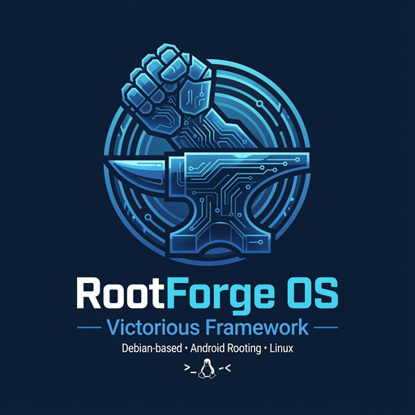

<!-- victorious-fleet-readme-refresh:start -->
<p align="center">
  
</p>

# rootforge-os

Android rooting / root-management app (EXTERNAL_NODE).

**Package id:** `ai.rootforge.os`

> **Package note:** From `android-app/app/build.gradle.kts`.

**Status:** CI green *(from [fleet-manifest ROADMAP](https://github.com/Victorious93/fleet-manifest/blob/main/ROADMAP.md))*

## Install / build

Android app under `android-app/`. Typical: `cd android-app && ./gradlew :app:assembleDebug` if wrapper present — verify in-repo.

_Steps above are taken from this repo’s build files / existing docs; anything not exercised in this refresh is unlabeled as verified on a device._

## Victorious fleet

- Monorepo: [https://github.com/Victorious93/victorious-fleet](https://github.com/Victorious93/victorious-fleet)
- Fleet site: [https://victorious-framework.pages.dev](https://victorious-framework.pages.dev)

<!-- victorious-fleet-readme-refresh:end -->

<p align="center">
  
</p>

# RootForge OS

**A Debian 12–based live/install distro and Termux rootfs toolkit for Android root-module development (Magisk, KernelSU, APatch), boot-image work, and device automation.**

**Victorious Framework — Origin Source Labs**

[-A81D33)](https://www.debian.org/)
[](BUILD.md)
[](#unified-cli)


> **Honesty first:** this repository contains a full Debian `live-build` tree, automation scripts, tests, and Termux/PRoot packaging. **ISO production, booting, Calamares install, and on-phone rootfs use have not been independently verified in the environment that last updated these docs** (no loop device / no published GitHub Release assets as of 2026-10-07). Tags `v0.1.0` / `v0.1.1` exist; no published Release yet. See [BUILD.md](BUILD.md) and [docs/PLATFORM_SUPPORT.md](docs/PLATFORM_SUPPORT.md).

## Overview

RootForge OS targets people building and testing Android root modules and boot images:

1. **Host ISO (x86_64 primary)** — Debian live image with GNOME + Calamares, Android SDK/NDK tooling (mostly first-boot), kernel/boot-image toolchain (magiskboot, avbtool, cross compilers), Magisk/KernelSU-oriented scripts, rooted/unrooted AVD helpers, OTA extraction, backups, and a unified `rootforge` CLI.
2. **On-device Debian rootfs (Termux)** — PRoot (unrooted) and chroot (rooted) flavours, optional XFCE via Termux:X11 — same project scripts where the Android kernel allows.

It does **not** claim a single unlock/root script for every OEM. Unlock/flash flows detect vendor constraints (Samsung/Xiaomi/etc.) and refuse to guess. Live ISO boot is **BIOS/isolinux only**; UEFI/Secure Boot are unsupported/unverified.

## Features

Grounded in `config/`, `termux/`, and the `rootforge` CLI (see also section-level detail in the long-form docs under `docs/`):

- **Live + installable Debian** — GNOME session, Calamares (erase / alongside / manual), system manifest for build provenance
- **Unified CLI** — `rootforge` groups: `doctor`, `devices`, `device`, `config`, `flash`, `backup`, `module`, `boot`, `ota`, `avd`
- **Module workflow** — Magisk/KernelSU(+APatch) scaffolds, package/push/install helpers, linting, Zygisk header templates
- **Boot & flash safety** — `device check` go/no-go, typed `FLASH <serial>` confirmation, slot-aware fastboot, audit logs + secret redaction
- **Backups** — partition backup/restore with `manifest.json`, verify/import-legacy paths
- **OTA / firmware** — extract/inspect helpers (payload-dumper-go pinned in image hooks)
- **AVD helpers** — create/list/start rooted or unrooted profiles (x86_64 host + KVM; not available on phone arm64)
- **AI tooling hooks** — Node 22, Claude Code (pinned), Ollama installer (unpinned — see BUILD.md), `brain` second-brain CLI
- **Termux delivery** — `termux/build-rootfs.sh` for proot/chroot (± X11); digest-required installers generated per release
- **CI & tests** — lint/unit/static hook checks; `release.yml` builds ISO + rootfs assets into a **draft** release after verification

## Screenshots

| Live GNOME desktop | Calamares installer | `rootforge doctor` | Module scaffold tree | Termux PRoot login | XFCE on Termux:X11 |
|---|---|---|---|---|---|
| *TODO* | *TODO* | *TODO* | *TODO* | *TODO* | *TODO* |

Capture only after a real boot/install; do not mock device serials or secrets in audit log screenshots.

## Requirements

### Build host (ISO)

- Debian 12 or Ubuntu 22.04+
- Packages: `live-build`, `debootstrap`, `squashfs-tools`, `xorriso`, `isolinux`, `syslinux-utils`
- Root, free loop device, **≥ 20 GB** disk, **≥ 4 GB** RAM (16 GB+ recommended if you will also run emulators + kernel builds)
- Details: [BUILD.md](BUILD.md)

### Runtime (installed system)

- x86_64 machine (arm64 secondary profile has emulator/KVM caveats)
- For Android emulator acceleration: `/dev/kvm`, user in `kvm` group

### Termux rootfs

- Termux on device; `proot-distro` for unrooted flavour; root/`su` for chroot flavour
- Multi-GB free storage; optional Termux:X11 app for desktop

## Build

```bash
git clone https://github.com/Victorious93/rootforge-os.git
cd rootforge-os

# Static checks (no root)
./tests/run-tests.sh
./tests/lint.sh

# ISO (as root on a suitable host)
sudo make build
# → rootforge-os-amd64.hybrid.iso (+ .sha256 when using make)
```

Termux rootfs examples:

```bash
sudo termux/build-rootfs.sh arm64
sudo termux/build-rootfs.sh arm64 --flavor chroot --with-x11
```

Release automation: `.github/workflows/release.yml` (draft release + checksum verification). **Has not been run successfully on GitHub’s infrastructure for a published Release yet.**

## Usage (installed or live)

```bash
rootforge doctor              # environment checks
rootforge devices             # adb/fastboot inventory
rootforge device check …      # go/no-go before writes
rootforge module scaffold …   # Magisk/KernelSU templates
rootforge flash boot …        # flash already-patched boot/init_boot (typed confirm)
rootforge backup create …     # partition backup with manifest
rootforge ota extract …       # payload extraction
rootforge avd create …        # rooted/unrooted AVD helpers (x86_64 host)
```

Flash/unlock/backup scripts refuse unsafe vendors/states where possible; they wipe or write only after explicit confirmation. Logs under `${ROOTFORGE_HOME:-$HOME/rootforge}/logs/` are created mode `0600` and redacted on exit (pattern-based — not a reason to print secrets).

USB flash helper (when you have an ISO + checksum): `make list-usb` / `sudo make flash USB=/dev/sdX`.

## Project structure

```text
auto/                 live-build entry (config, build)
config/               package lists, hooks, includes.chroot (scripts under usr/local/bin)
termux/               PRoot/chroot rootfs build + release metadata templates
tests/                Hermetic tests + stubs (adb/fastboot/su/…)
docs/                 ARCHITECTURE, PLATFORM_SUPPORT, SECURITY_MODEL, …
Makefile              build, checksum, flash, clean targets
BUILD.md              ISO build guide
HACKING.md · AGENTS.md · CLAUDE.md
```

Deep design notes that used to dominate the homepage README live in `docs/` and [BUILD.md](BUILD.md). Prefer updating those for long rationale; keep this README as the landing page.

## Contributing

1. Run `./tests/run-tests.sh` and hook checks before PRs.
2. Preserve fail-closed device gates and typed confirmations on destructive paths.
3. Pin and verify downloaded artifacts in hooks (`tests/check-hooks.sh` enforces several rules).
4. Do not claim hardware verification you did not perform — use the Certain/Likely/Guessing language from existing docs when needed.
5. See [HACKING.md](HACKING.md) and [AGENTS.md](AGENTS.md).

## License

**No `LICENSE` file is present in this repository.** Add an SPDX license (and decide how Debian package licenses / pinned third-party binaries should be attributed) before advertising the project as open source. Until then, redistribution terms are undefined.

Third-party components fetched at build time (NodeSource, Ollama installer, Magisk APK for magiskboot, GitHub release binaries, etc.) remain under their own licenses — see hooks under `config/hooks/` and [BUILD.md](BUILD.md).

## Documentation map

| Doc | Purpose |
|---|---|
| [BUILD.md](BUILD.md) | How to build the ISO; what is pinned vs not |
| [docs/ARCHITECTURE.md](docs/ARCHITECTURE.md) | System architecture |
| [docs/PLATFORM_SUPPORT.md](docs/PLATFORM_SUPPORT.md) | BIOS-only live ISO; arch caveats |
| [docs/SECURITY_MODEL.md](docs/SECURITY_MODEL.md) | Trust boundaries, logging, flashing gates |
| [CHANGELOG.md](CHANGELOG.md) | Unreleased changes (no published Release yet) |
| [tests/README.md](tests/README.md) | Test and release-verifier notes |

## Acknowledgements

Debian live-build, Magisk, KernelSU, AOSP tooling, Termux / proot-distro, and the many pinned upstream projects pulled by image hooks. RootForge OS is part of the Victorious Framework alongside related repos (e.g. droidcommand-AI’s `core-rootforge` client — passive reads only today).
