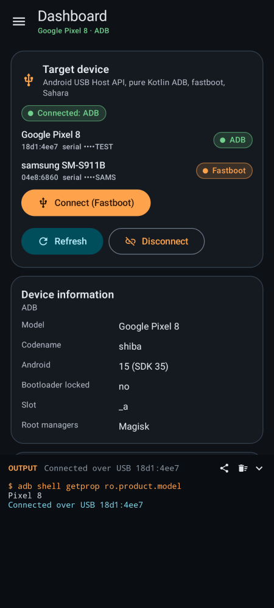
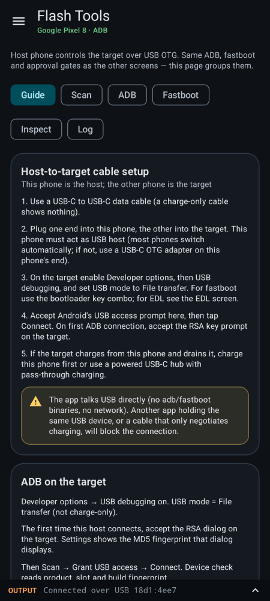
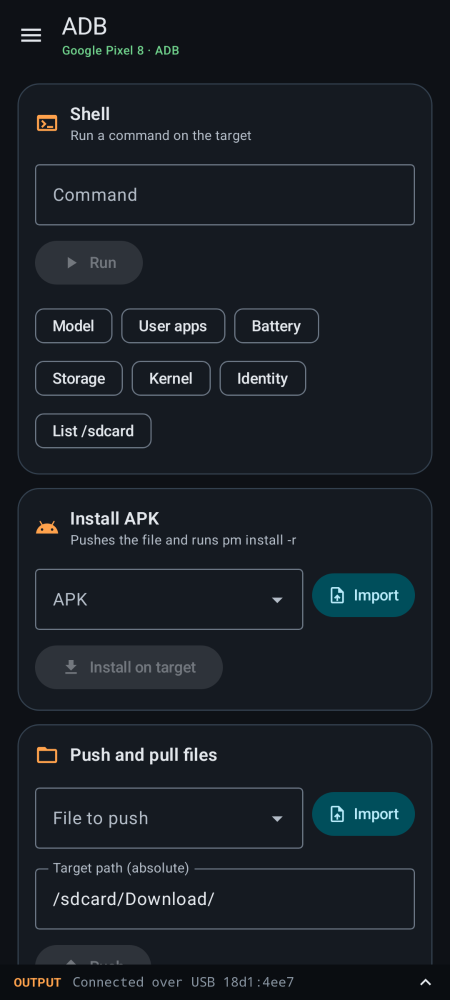
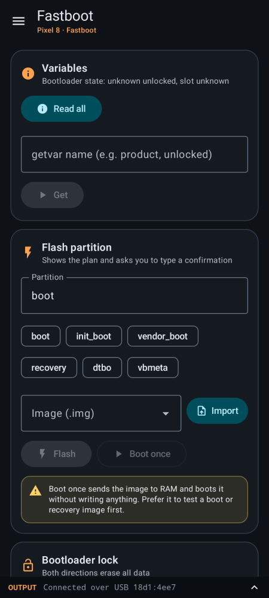
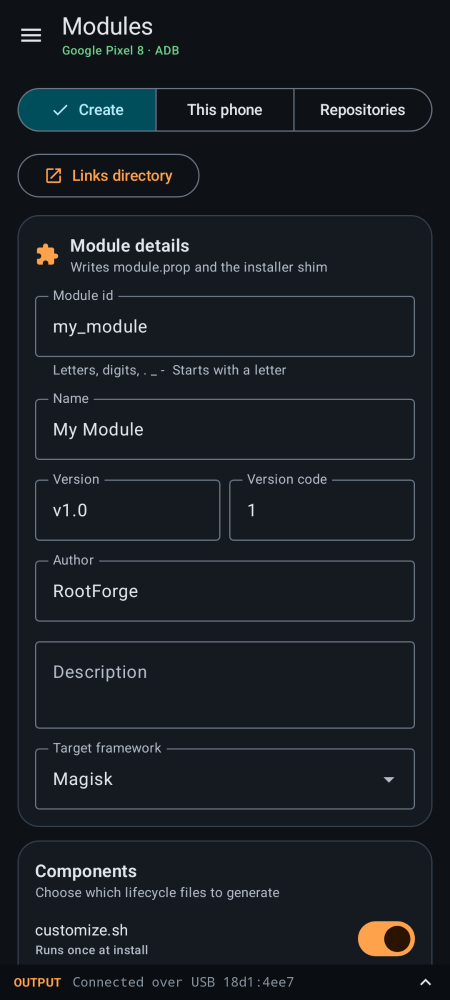
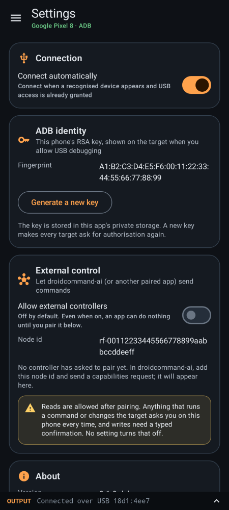
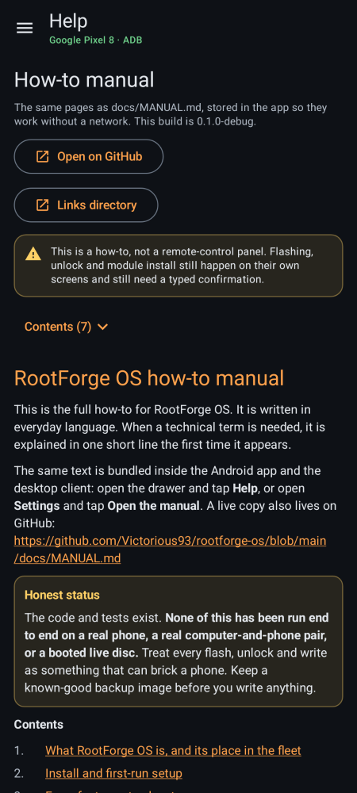

<p align="center">
  
</p>

<h1 align="center">RootForge OS</h1>

<p align="center">
  <strong>Tools for building Android root modules and working with boot images, as a Debian distro, a Termux command-line tool, an Android app that controls a second phone over USB, and desktop/Docker versions of the same.</strong>
</p>

<p align="center">
  <a href="https://github.com/Victorious93/rootforge-os/actions/workflows/lint.yml"></a>
  <a href="https://github.com/Victorious93/rootforge-os/actions/workflows/android-apk.yml"></a>
  <a href="https://github.com/Victorious93/rootforge-os/actions/workflows/toolkit.yml"></a>
  <a href="LICENSE"></a>
  <a href="android-app/core/LICENSE"></a>
  
  
  
</p>

> **Status, plainly:** the code, scripts, tests and packaging are all in this repository, but
> **none of it has been run end to end on real hardware.** The Debian ISO has never been built or
> booted here (the build environment has no loop device), the Android and desktop apps have never been
> run on a real phone/PC pair, and the one published release (v0.2.0) is a *debug* Android APK only,
> with no ISO and no Termux rootfs. What exists is source code that compiles, plus automated tests
> that use stand-ins (stubs) instead of real devices. Nothing is cryptographically signed except
> debug APKs (see [Signing](#signing)). Details: [docs/PLATFORM_SUPPORT.md](docs/PLATFORM_SUPPORT.md) and
> [docs/SECURITY_MODEL.md](docs/SECURITY_MODEL.md).

**Contents:**
[What it is](#what-it-is) ·
[Where it fits in the Victorious fleet](#where-it-fits-in-the-victorious-fleet) ·
[The Android host-phone app](#the-android-host-phone-app) ·
[Install and run](#install-and-run) ·
[Build from source](#build-from-source) ·
[Signing](#signing) ·
[Command-line usage](#command-line-usage) ·
[Project layout](#project-layout) ·
[Docs](#documentation) ·
[License](#license)

## What it is

RootForge OS is a toolbox for people who work on rooted Android phones. "Rooting" means getting
administrator-level access to the phone's system; a "root module" is a small add-on (for Magisk,
KernelSU or APatch, which are root managers) that changes how the system behaves. RootForge helps you
build those modules, patch and flash boot images, and run backups, OTA-update extraction and emulator
setups. It does **not** claim one unlock or root script for every phone maker. Each flow checks what
kind of device it is talking to and refuses to continue when it can't tell.

There is one set of device rules (the `rootforge` command-line tool and its scripts), delivered
through several front ends:

| Front end | What it is | Where |
|---|---|---|
| **Termux CLI** | The same `rootforge` Python tool, run from a git clone inside Termux (a terminal app for Android). A full Debian-in-Termux rootfs is a separate, release-generated download that does not exist yet | [Install: CLI](#command-line-tool-from-a-git-clone-linux-or-termux), `termux/` |
| **Host-phone APK** | An Android app. One phone (the *host*) controls a second phone (the *target*) over a USB cable using Android's USB Host feature. Written in Kotlin; it contains its own ADB, fastboot and EDL code and does not bundle Google's `adb` binary | `android-app/app`, [docs/ANDROID_APP.md](docs/ANDROID_APP.md) |
| **Linux / Windows desktop** | The same screens as the app, but talking to the `adb` and `fastboot` programs installed on your computer (and optionally `edl`) | `android-app/desktop`, [docs/DESKTOP.md](docs/DESKTOP.md) |
| **Docker toolkit** | The `rootforge` CLI plus `adb`/`fastboot` and a small local web API | `docker/`, [docker/README.md](docker/README.md) |
| **Debian ISO** (x86_64) | A Debian 12 live/install image with GNOME, the Calamares installer, Android SDK/NDK tooling, boot-image tools and the CLI. Boots in BIOS mode only; UEFI and Secure Boot are not supported | `config/`, `auto/`, [BUILD.md](BUILD.md) |

### What the command-line tool does

- **Device checks before writes.** `device check` gives a go/no-go for the connected phone. Writes need a typed confirmation such as `FLASH <serial>`. An unknown slot, lock state or product blocks the write.
- **Backups.** Partition backup and restore with a `manifest.json`, verify, and import of the older layout.
- **Modules.** Magisk / KernelSU / APatch scaffolds, package/push/install helpers, linting, Zygisk header templates. Module names are shell-quoted in the generated `customize.sh`.
- **OTA and boot images.** Payload extraction and inspection, boot patch and flash helpers.
- **Emulator helpers.** Create, list and start rooted or unrooted Android emulator profiles (needs an x86_64 computer with KVM, the Linux virtualization feature).
- **Logs.** Private (`0600`) JSON-lines logs with secret redaction and an audit trail for state-changing commands.

### Words used in this README

| Term | Meaning |
|---|---|
| **ADB** | Android Debug Bridge: the standard way for a computer (or here, another phone) to talk to a running Android phone |
| **Fastboot** | The bootloader's own mode, used to flash partitions and unlock the bootloader |
| **EDL / Sahara / Firehose** | Qualcomm's low-level "emergency download" mode (USB ID 9008) and its two protocols |
| **USB OTG / USB Host** | Lets a phone act as the "computer" end of a USB cable instead of the device end |
| **Sidecar manifest** | A small `<image>.manifest.json` file placed next to an image that says which device it is for |
| **Typed confirmation** | Dangerous actions print a plan and make you type an exact phrase (for example `FLASH boot`) before anything is written |
| **Termux / PRoot** | Termux is a terminal app for Android; PRoot lets it run a Debian userland without root |

## Where it fits in the Victorious fleet

RootForge OS is one app in the Victorious set of Android tools, which is coordinated from the controller
app **droidcommand-AI** (DCA, <https://github.com/Victorious93/droidcommand-AI>). DCA sorts the apps it
knows about into classes. RootForge is in the **`EXTERNAL_NODE`** class: an independent product that
DCA can talk to, not a "companion" that depends on DCA.

What that means in practice:

- **It works without DCA.** Removing DCA, or never pairing with it, disables no RootForge feature. RootForge does not check whether DCA is installed.
- **How they talk.** On the phone, DCA binds to RootForge's Android **Messenger** service (action `ai.rootforge.os.action.BRIDGE`; the debug build's package is `ai.rootforge.os.debug`) and sends one JSON request line per message (`what=1`, key `request`). RootForge answers with one JSON line (`what=2`, key `response`). A Messenger is Android's simple message-passing channel between two apps.
- **Shared JSON protocol.** Every request and response carries `protocol_major: 1`. A request with a different major version is rejected, not guessed at. The envelope and the 11 operations are specified in [docs/DROIDCOMMAND_INTEGRATION.md](docs/DROIDCOMMAND_INTEGRATION.md) and implemented in `android-app/core/.../bridge/`.
- **Pairing and trust.** RootForge decides who may control it by the caller's **package name plus signing-certificate hash**, which Android reports for the calling app. It is never a field the caller writes into the JSON. The owner pairs a controller by hand in **Settings → External control**. If the controller app is re-signed with a different certificate, it shows up as pending again and must be re-paired.
- **No shared signing key.** The Messenger service is exported with no signature permission, so the two apps can be signed with different keys. Binding to the service grants nothing by itself.
- **Switched off by default.** "Allow external controllers" starts **off**. An unpaired caller is only recorded as pending, and cannot do anything until the owner pairs it.

Pairing steps:

1. Open RootForge → Settings → External control and copy the **Node id** (`rf-` plus 32 hex characters, generated once per install).
2. Have DCA bind the action and send `rootforge.capabilities.get` with that node id. The first reply is `not_paired` or `bridge_disabled`. That is expected, and the caller is now listed as pending.
3. Turn **Allow external controllers** on, then **Pair** the pending package and certificate.

After that, read operations (list devices, device info, capabilities) run. Control operations
(ADB shell, reboot, build a module zip) ask the person holding the host phone to approve each call.
Destructive operations (flash, slot switch, bootloader unlock/lock) use the same typed confirmation
as the app screens. EDL, sideloading a zip, raw `fastboot oem`, erase, APK install and push/pull are **not**
available over the bridge (they return `unknown_operation`).

How sure are these claims? Checked against this repository's code and tests, and against the
droidcommand-AI `main` branch when this README was refreshed (2026-10-18):

- **[Certain]** from this repo: the Messenger action, message numbers and keys, `protocol_major` 1, the pairing-by-package-and-certificate rule, the default-off switch, the exported service with no signature permission, the operation list.
- **[Certain]** from droidcommand-AI's source: its fleet catalog marks RootForge as `EXTERNAL_NODE`, and its `core-rootforge` module mirrors the same envelope with `BRIDGE_PROTOCOL_MAJOR = 1`.
- **[Certain]** that DCA does **not** yet have an Android Messenger client for RootForge: its `core-rootforge` only has an SSH transport today. The one-file client sketch in [docs/DROIDCOMMAND_INTEGRATION.md](docs/DROIDCOMMAND_INTEGRATION.md) is what DCA would need.
- **[Likely]** that the pairing flow above works against a real DCA install. It is unit-tested on the RootForge side, but nobody has installed both apps on one phone, so a live session is unconfirmed.
- **[Likely]** that DCA's `<queries>` entries (`ai.droidcommand.app`, `ai.droidcommand.app.debug`) cover the DCA package names in use. A DCA build with another package name would be refused as `not_paired` until that list is extended.
- **[Guessing]** how the wider fleet (VictorSuite, EDL-Commander and others) will call RootForge in future. Only the boundaries in the docs are known: Termux/PRoot work stays with VictorSuite, and Sahara/Firehose correctness stays with EDL-Commander.

The desktop and Docker clients use the same JSON envelope over local HTTP instead
([docs/DESKTOP.md](docs/DESKTOP.md)). That is a separate path from Messenger. There is also an SSH
route from DCA's side that is read-only (`capabilities`, `devices.list`); the `rootforge bridge` command
that route would call is not in the CLI yet.

The shared Kotlin module `android-app/core` (`:core`) is **Apache-2.0** so other Victorious apps can reuse the flash
planner, device-match check, approvals and bridge envelope without taking on the GPL app code.

## The Android host-phone app

The app in `android-app/app` runs on a **host** phone and drives a **target** phone plugged into it with a
USB-C data cable. It needs a phone with USB Host hardware (`android.hardware.usb.host` is a required
feature) and Android 8.0 or newer (`minSdk 26`). It is not a Termux fork and carries no Linux userspace.
The app requests the internet permission for one thing only: the **Download** button on the Dashboard's
"Builds for this device" card, which fetches the Custom RR catalog over https
([docs/CUSTOM_RR_CATALOG.md](docs/CUSTOM_RR_CATALOG.md)). Device work never uses the network.

Screens: Dashboard, **Ask**, **Root Guide**, **Help**, **Flash Tools**, ADB, Fastboot, EDL (experimental), Root / Patching,
Modules (creator and repository links), Recovery, Logs / Terminal, Settings.

**Root Guide** is offline rooting documentation inside the app (bootloader unlock, Magisk / KernelSU / APatch,
device guides, FAQ, troubleshooting) with search. Most pages are adapted from
[Awesome Android Root](https://github.com/awesome-android-root/awesome-android-root) (MIT); one page maps the
guides' steps onto this app's screens. It is reference text only and has not been checked on hardware here.
See [docs/ROOT_GUIDE.md](docs/ROOT_GUIDE.md).

### Flash Tools

Flash Tools is a guided hub whose buttons call the same controller code as the dedicated screens. There is
no second USB stack.

| Pane | What it does |
|---|---|
| **Guide** | Cable, OTG adapter, USB debugging, bootloader key combo, first RSA prompt |
| **Scan** | Refresh attached USB devices; lists ADB / fastboot / EDL targets apart from ignored ones (keyboards, charge-only); grant permission and connect |
| **ADB** | Device check (product, slot, fingerprint), shell, packages, push/pull, logcat, screen info, screenshot |
| **Fastboot** | Product and partition info, unlock (typed `UNLOCK`), flash a library image (device-match check, then typed `FLASH <partition>`), reboot |
| **Inspect** | Image or APK kind, size, SHA-256, sidecar claim, typed-hex verify. Does not talk to the target |
| **Log** | The same redacted log as the output panel, saved as `command-log.jsonl` (app files dir; desktop: `~/.rootforge/command-log.jsonl`) |

**Manifest check.** A flash is **refused** unless a sidecar `<image>.manifest.json` matches the target:
product or codename, slot, and either the build fingerprint or a declared product/slot claim. If the
manifest includes a `sha256`, the file must match it. A mismatch is logged as `Refused: …` and nothing is
written. There is no setting to override this. The same check runs on the dedicated Fastboot, Recovery and
Root screens and in the desktop client. Manifest format: [docs/FLASH_TOOLS_PLAN.md](docs/FLASH_TOOLS_PLAN.md).

**Typed confirmations.** Writes (flash, erase, unlock, lock, slot switch, Firehose program, EDL programmer
upload) print a plan and need a typed phrase. Unlock also shows a large warning about factory reset,
Knox / Widevine / banking apps and warranty. A USB device appearing is never treated as permission.

**Other things that exist:** patching is done by pushing a boot image to the target, opening Magisk /
KernelSU / APatch there, pulling the patched image back and flashing it (the app does not reimplement
patching); a module zip builder; a recovery sideload client (it seeks the zip as recovery asks, which is
tested with a fake device only).

**EDL is experimental, and the larger EDL plan is only a plan.** The EDL screen is a Kotlin Sahara/Firehose
client tested against a fake device. It ships no OEM programmer, and retail phones accept only the
maker-signed one. Reusing the EDL-Commander Rust code through JNI (Android's native-code bridge) is
**planned only** ([docs/FLASH_TOOLS_PLAN.md](docs/FLASH_TOOLS_PLAN.md), Phase 4). It is not implemented,
and no NDK or JNI code is in the tree.

**Known limits:** raw images bigger than the target's `max-download-size` are refused (sparse images that
fit are flashed); ADB uses classic `shell:`, not shell_v2, and has no `adb forward`; logcat holds the USB
connection until stopped. More in [docs/ANDROID_APP.md](docs/ANDROID_APP.md).

### Screenshots

Rendered by Paparazzi unit tests with sample data. **These are not captures from a real phone.**

| Dashboard | Flash Tools | ADB | Fastboot | Modules | Settings | Help |
|---|---|---|---|---|---|---|
|  |  |  |  |  |  |  |

Live ISO, Calamares installer and Termux screenshots will come after a real boot and install.

## Install and run

### Android app (debug APK)

**v0.2.0** is the first published GitHub Release. It carries a **debug** build of the host-phone app
(package `ai.rootforge.os.debug`, version name `0.1.0-debug`). There is no release-signed APK.

- Release page: <https://github.com/Victorious93/rootforge-os/releases/tag/v0.2.0>
- APK: <https://github.com/Victorious93/rootforge-os/releases/download/v0.2.0/rootforge-os-android-debug.apk>
- SHA-256 of that file (the same digest GitHub reports for the asset, and the release also has a `.sha256` file): `faf743faba1b14aa5288f69883a0a1e2c284e43a77d7b32575ea3aaed8045e2f`. Compare with `sha256sum rootforge-os-android-debug.apk`.

Install it on the **host** phone (the one that will control the other phone):

1. **From a computer with `adb`** (USB debugging on the host phone):
   ```bash
   adb install -r rootforge-os-android-debug.apk
   ```
2. **Or on the phone itself:** download or copy the APK to the host phone, open it, and allow "install unknown apps" for the app you opened it from when Android asks. This is the normal Android sideload route. It has not been tested for this project.

**Updating from v0.2.0:** the v0.2.0 APK was signed with a different, auto-generated debug key, so Android
will refuse to install a newer build over it. Uninstall it **once**
(`adb uninstall ai.rootforge.os.debug`, or uninstall from the phone's app settings). **This deletes the
app's data.** Builds made after that share one fixed debug key and update in place with `adb install -r`
(see [Signing](#signing)).

To use it:

1. Plug the **target** phone into the host with a USB-C **data** cable (charge-only cables show nothing). If the host does not switch into USB-host mode by itself, put a USB-C OTG adapter on the **host** end.
2. On the target, turn on USB debugging (or reboot to the bootloader).
3. In the app: Flash Tools → Scan (or Dashboard → Connect). Accept Android's "allow this app to access the USB device?" prompt on the host. On first ADB use, accept the RSA-key dialog on the **target**.

Destructive actions print a plan and require a typed phrase. To let droidcommand-AI control the app, see
[Where it fits in the Victorious fleet](#where-it-fits-in-the-victorious-fleet).

### Command-line tool from a git clone (Linux or Termux)

The CLI is built to run from a working tree: `runner.py` finds the `usr/local/bin` scripts next to the
Python package. The installed `rootforge` shim hardcodes `PYTHONPATH=/usr/local/lib` and is meant for the
ISO and rootfs, not a checkout.

```bash
git clone https://github.com/Victorious93/rootforge-os.git
cd rootforge-os
export PYTHONPATH="$PWD/config/includes.chroot/usr/local/lib"
python3 -m rootforge.core.cli doctor
```

Device work also needs `adb`, `fastboot`, `jq`, `curl`, `unzip`, `zip` and `sha256sum` on `PATH`. PyYAML
(`python3-yaml`) is optional except for `rootforge config`. `rootforge doctor` lists what is missing. This
is the Termux CLI path today. It is **not** the Debian-in-Termux rootfs and has **not been run on a phone**.

### Desktop (Linux / Windows)

No prebuilt desktop packages are published. Build them yourself ([Build from source](#build-from-source)),
or take the `.deb`, AppImage, `.exe` (and, when it builds, `.msi`) from the `toolkit.yml` CI run artifacts
(kept for 7 days). You need `adb` and `fastboot` on `PATH` or in `ANDROID_HOME/platform-tools`. On Windows,
USB drivers are **not** bundled: see [docs/DESKTOP.md](docs/DESKTOP.md). Not run against a real phone.

### Docker toolkit

Build the image locally (no prebuilt image is published), then run it with USB passed through. Linux only:

```bash
docker build -f docker/Dockerfile -t rootforge-os-toolkit .
export ROOTFORGE_API_TOKEN="$(openssl rand -hex 16)"
docker run --rm -it --privileged --device /dev/bus/usb \
  -v /dev/bus/usb:/dev/bus/usb -p 127.0.0.1:8787:8787 \
  -e ROOTFORGE_API_TOKEN rootforge-os-toolkit
```

Publish the port on `127.0.0.1` only. Details: [docker/README.md](docker/README.md). The image build is
exercised by CI (`toolkit.yml`); it has not been run against a phone.

### Debian ISO and Termux rootfs

No prebuilt ISO or rootfs exists. To build them see [Build from source](#build-from-source). To write an
ISO to a USB stick: `sudo make flash USB=/dev/sdX` (checks the checksum if present; `make list-usb` shows
candidates). Install scripts for a rootfs are generated per release by `termux/make-release-metadata.sh`
from the real tarballs. The checked-in templates deliberately refuse to run.

### What each piece needs

| Target | Needs |
|---|---|
| CLI from a clone | Python 3; for device work `adb`/`fastboot`, `jq`, `curl`, `unzip`, `zip`, `sha256sum`. Optional: PyYAML |
| Phone app (use) | A phone with USB Host, Android 8.0+, a USB-C **data** cable |
| Phone app (build) | JDK 17+ and the Android SDK (`ANDROID_HOME` or `local.properties` `sdk.dir`) |
| Desktop (build) | JDK 17; `adb`/`fastboot` at run time |
| Docker | Docker Engine on Linux for USB passthrough; `ROOTFORGE_API_TOKEN` |
| ISO build | Debian 12 or Ubuntu 22.04+; `live-build`, `debootstrap`, `squashfs-tools`, `xorriso`, `isolinux`, `syslinux-utils`; root, a free loop device, 20 GB+ disk, 4 GB+ RAM |
| Installed ISO | x86_64; `/dev/kvm` and `kvm` group membership for emulator speed |
| Termux rootfs | Termux; `proot-distro` (no root) or `su` (chroot); several GB free; optional Termux:X11 |

## Build from source

```bash
git clone https://github.com/Victorious93/rootforge-os.git
cd rootforge-os

# Static checks and hermetic tests (no root, device or network)
bash tests/run-tests.sh
bash tests/lint.sh            # needs shellcheck
```

**Android debug APK** (Gradle wrapper, JDK 17, Android SDK):

```bash
cd android-app
./gradlew :core:test :app:testDebugUnitTest :app:assembleDebug
# APK: app/build/outputs/apk/debug/app-debug.apk   (package ai.rootforge.os.debug)
adb install -r app/build/outputs/apk/debug/app-debug.apk
```

This is the same command CI runs. `:app:testDebugUnitTest` includes the protocol tests and the Paparazzi
screenshot tests; `./gradlew :app:verifyPaparazziDebug` re-checks only the screenshots.

**Desktop:**

```bash
cd android-app
./gradlew :desktop:run                          # desktop GUI
./gradlew :desktop:run --args='--headless --port 8787'   # local JSON API
./gradlew :desktop:packageDeb                   # Linux .deb
./gradlew :desktop:packageAppImage              # Linux AppImage (also built in CI)
./gradlew :desktop:packageExe                   # Windows .exe (run on Windows; use gradlew.bat)
```

CI (`toolkit.yml`) also tries a Windows `.msi` (`:desktop:packageMsi`). That artifact is optional if
WiX/jpackage cannot make it. `:desktop` needs the Android SDK only because it lives in the same Gradle build as `:app`.

**Docker:** `docker build -f docker/Dockerfile -t rootforge-os-toolkit .`

**Debian ISO** (live-build, run as root on a suitable host):

```bash
sudo make build               # -> rootforge-os-amd64.hybrid.iso
make checksum                 # -> rootforge-os-amd64.hybrid.iso.sha256
```

**Termux rootfs** (run as root on a Linux host; the tarball is then installed in Termux):

```bash
sudo termux/build-rootfs.sh arm64
sudo termux/build-rootfs.sh arm64 --flavor chroot --with-x11
```

**CI workflows** in `.github/workflows/`:

| Workflow | Runs on | What it does |
|---|---|---|
| `lint.yml` | PRs, pushes to `main` | shellcheck, YAML lint, package-list check, `tests/run-tests.sh`, Python checks |
| `android-apk.yml` | PRs, pushes to `main`, `v*` tags | `:core:test :app:testDebugUnitTest :app:assembleDebug`, uploads the debug APK; builds a release APK only if signing secrets exist |
| `toolkit.yml` | PRs, pushes to `main`, `v*` tags | Linux desktop (`.deb`, AppImage), Windows desktop (`.exe`, optional `.msi`), Docker image build |
| `release.yml` | `v*` tags, manual | Builds a debug APK and attaches it (plus a `.sha256`) to a published release; ISO and Termux rootfs go to a *draft* after live-build and checksum verification. The `v0.2.0` run's `release` job failed on a file-permission bug that is fixed on `main`; the APK step has not yet run on a tag |

## Signing

**Debug builds.** Every debug build, local or CI, is signed with one committed, app-specific key:
`android-app/app/debug.keystore` (alias `androiddebugkey`, passwords `android`). Its certificate SHA-256 is:

```text
77:7A:C7:00:87:05:A8:B4:B8:93:AC:EF:0E:03:E9:1C:7F:49:52:C9:52:FE:B2:6E:06:D7:90:B9:14:86:64:6F
```

- It is **debug only** and is **not a secret**: it is in the repository and anyone can sign with it. A debug signature therefore proves nothing about who built an APK.
- Because the key is fixed, a new debug APK installs over an older one with `adb install -r` and keeps its data.
- **v0.2.0 debug users must uninstall once**, because that APK used a different auto-generated key (see [Install](#android-app-debug-apk)).
- Check an APK against the key: `apksigner verify --print-certs app-debug.apk`, and compare with `keytool -list -v -keystore android-app/app/debug.keystore -storepass android`.

**Release builds.** The release key lives **only in CI secrets** and is never committed. `android-apk.yml`
builds a release APK only when the repository secrets `ROOTFORGE_KEYSTORE_BASE64`,
`ROOTFORGE_KEYSTORE_PASSWORD`, `ROOTFORGE_KEY_ALIAS` and `ROOTFORGE_KEY_PASSWORD` exist (the keystore is
decoded to a temporary file on the runner; Gradle reads `ROOTFORGE_KEYSTORE_FILE` and the other
`ROOTFORGE_*` values from the environment). Without them no release APK is built, and that is not a CI
failure. **As of the project notes dated 2026-10-17 those secrets were absent, so no release-signed APK
has been produced.** Never commit a keystore, password or `.env` file.

**Fleet apps.** There is no shared signing key across the Victorious apps and none is wanted. Each app is
trusted by its package name and certificate hash after the owner pairs it (see
[Where it fits in the Victorious fleet](#where-it-fits-in-the-victorious-fleet)).

## Command-line usage

```bash
export PYTHONPATH="$PWD/config/includes.chroot/usr/local/lib"   # skip on an installed ISO/rootfs
python3 -m rootforge.core.cli doctor              # environment checks
python3 -m rootforge.core.cli devices             # adb/fastboot inventory
python3 -m rootforge.core.cli device check …      # go/no-go before writes
python3 -m rootforge.core.cli module scaffold …   # Magisk/KernelSU templates
python3 -m rootforge.core.cli flash boot …        # flash an already-patched boot/init_boot (typed confirm)
python3 -m rootforge.core.cli backup create …     # partition backup with manifest
python3 -m rootforge.core.cli ota extract …       # payload extraction
python3 -m rootforge.core.cli avd create …        # rooted/unrooted AVD helpers (x86_64 host)
```

Command groups: `doctor`, `devices`, `device`, `config`, `flash`, `backup`, `module`, `boot`, `ota`, `avd`.
On an installed ISO or Termux rootfs the same commands are `rootforge doctor`, `rootforge devices`, and so on.

Flash, unlock and backup scripts refuse unsafe vendors and states where they can, and write only after
explicit confirmation. CLI confirmations are `FLASH <serial>`, `UNLOCK <serial>` and `RESTORE <serial>`,
typed on `/dev/tty`. Logs go under `${ROOTFORGE_HOME:-$HOME/rootforge}/logs/`, are created `0600` and are
redacted on exit. The redaction is pattern-based, so do not rely on it to hide secrets.

## Project layout

```text
auto/                 live-build entry (config, build)
config/               package lists, hooks, includes.chroot (scripts under usr/local/bin)
termux/               PRoot/chroot rootfs build + release metadata templates
android-app/          :core (shared, Apache-2.0), :app (Android APK), :desktop (Linux/Windows)
docker/               Toolkit image (CLI + local API)
tests/                Hermetic tests + stubs (adb/fastboot/su/…)
docs/                 Architecture, platform support, security model, app docs, …
Makefile · BUILD.md · HACKING.md · AGENTS.md · CLAUDE.md
```

## Documentation

| Doc | Purpose |
|---|---|
| [BUILD.md](BUILD.md) | ISO build guide; what is pinned vs not |
| [docs/ARCHITECTURE.md](docs/ARCHITECTURE.md) | System architecture |
| [docs/PLATFORM_SUPPORT.md](docs/PLATFORM_SUPPORT.md) | BIOS-only live ISO; architecture caveats |
| [docs/SECURITY_MODEL.md](docs/SECURITY_MODEL.md) | Trust boundaries, logging, flashing gates |
| [docs/ANDROID_APP.md](docs/ANDROID_APP.md) | Host-phone APK: USB Host, screens, install, debug key, limits |
| [docs/MANUAL.md](docs/MANUAL.md) | How-to manual (plain language). Same text is the in-app **Help** screen |
| [docs/ROOT_GUIDE.md](docs/ROOT_GUIDE.md) | Root Guide: bundled pages, importer, parser, refresh procedure, limits |
| [docs/FLASH_TOOLS_PLAN.md](docs/FLASH_TOOLS_PLAN.md) | Flash Tools hub, device-match check, manifest format, EDL-Commander plan |
| [docs/CUSTOM_RR_CATALOG.md](docs/CUSTOM_RR_CATALOG.md) | "Builds for this device" card: Custom RR ROM/recovery catalog by codename, download or import |
| [docs/DESKTOP.md](docs/DESKTOP.md) | Linux/Windows desktop, Windows USB drivers, Docker |
| [docs/DROIDCOMMAND_INTEGRATION.md](docs/DROIDCOMMAND_INTEGRATION.md) | Bridge protocol for droidcommand-AI (Messenger, JSON envelope, pairing) |
| [tests/README.md](tests/README.md) | Test and release-verifier notes |
| [CHANGELOG.md](CHANGELOG.md) | v0.2.0 and later notes |
| [LICENSE](LICENSE) · [NOTICE](NOTICE) | GPL-3.0-or-later text; split-license and third-party notices |
| [android-app/core/LICENSE](android-app/core/LICENSE) | Apache-2.0 text for shared Kotlin `:core` |
| [docs/README-legacy.md](docs/README-legacy.md) | Archived long-form README |

## Contributing

1. Work on a branch and open a pull request. Do not push to `main`.
2. Run `bash tests/run-tests.sh` and `bash tests/lint.sh` before opening a PR.
3. Keep device checks fail-closed and destructive paths behind typed confirmation.
4. Pin and verify downloaded artifacts in hooks (`tests/check-hooks.sh` enforces several rules).
5. Do not claim hardware verification you did not perform.

See [HACKING.md](HACKING.md) and [AGENTS.md](AGENTS.md).

## License

RootForge OS uses a **split license**. Original work in this repository is **GPL-3.0-or-later**, except the
shared Kotlin module **`android-app/core` (`:core`)**, which is **Apache License 2.0**.

| Tree | License | Text |
|---|---|---|
| `android-app/core/` (`:core`) | Apache-2.0 | [android-app/core/LICENSE](android-app/core/LICENSE) |
| Everything else (CLI, scripts, ISO/live-build, Termux packaging, `:app`, `:desktop`, Docker toolkit, tests, docs) | GPL-3.0-or-later | [LICENSE](LICENSE) |

Copyright, the GPL applying notice ("version 3 or later") and third-party attribution are in
[NOTICE](NOTICE). Apache-2.0 is compatible with GPL-3.0: combining `:core` into the GPL-licensed Android app
or desktop client does **not** relicense the `:core` sources. Those stay Apache-2.0 so they can be reused on
their own terms by other Victorious projects. Combined binaries are GPL-3.0-or-later.

**Third-party code is not relicensed.** Debian packages in the ISO and rootfs, Termux / PRoot /
proot-distro, Magisk / KernelSU / APatch, the Android SDK/NDK, Node.js, Ollama, Claude Code, Calamares and
other build-time downloads keep their upstream licenses. This repository does not vendor those projects; it
ships RootForge installers, plugins, branding and pinned fetchers. See [BUILD.md](BUILD.md) and `config/hooks/`.

## Credits

Built on Debian live-build, Magisk, KernelSU, APatch, AOSP tooling, Termux and proot-distro, plus the pinned
upstream projects pulled in by the image hooks. RootForge OS is not a fork of any of them.
